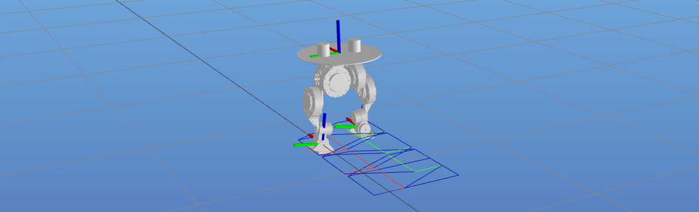

# Motion Generator

Small toolkit for **humanoid gait / motion generation** with [PlaCo](https://github.com/Rhoban/placo): it plans walking patterns, records time-series episodes (poses, velocities, contacts) for simulation or datasets, and provides helpers to visualize the URDF or replay saved JSON.

## Requirements

### Python

- Recommended environment: **Conda `env_placo` with Python 3.11**.
- The package metadata allows Python 3.9+, but the checked setup in this repository is the Conda environment from `environment.yml`.
- On Windows, install PlaCo and compiled dependencies with `conda-forge`. Avoid `pip install placo`; it may try to build native dependencies and fail.

Create the checked environment:

```bash
conda env create -f environment.yml
conda activate env_placo
pip install -e .
```

If `env_placo` already exists, update it from the repository file:

```bash
conda activate env_placo
conda env update -f environment.yml --prune
pip install -e .
```

Manual setup for an existing Conda environment:

```bash
conda activate env_placo
conda install -c conda-forge placo "coal=3.0.2=h1ea47a8_1" numpy scipy matplotlib
pip install -r requirements.txt
pip install -e .
```

Runtime stack:

- **placo**, **placo_utils**: Meshcat, IK, walk-pattern pipeline
- **numpy**, **scipy**: motion data and rotations
- **matplotlib**: replay velocity plots
- **ischedule**: `scripts/view_robot.py`
- **FramesViewer**: optional 3D replay in `scripts/replay_motion.py`

### OpenGL / GLUT (optional, for `replay_motion.py` 3D viewer)

If you see `glutInit` / `NullFunctionError`, install native GLUT (Debian/Ubuntu example):

```bash
sudo apt install freeglut3-dev
```

Or run replay **without** the OpenGL window using `--no-viewer` (see below).

---

## Scripts

Some PlaCo wheels ship native libraries under `site-packages/cmeel.prefix/lib`. If the loader fails to find them (missing `.so` / import errors), prepend that directory to `LD_LIBRARY_PATH`. Replace the path with your Conda env name and Python version as needed.

```bash
export LD_LIBRARY_PATH="/home/csi/anaconda3/envs/env_placo/lib/python3.11/site-packages/cmeel.prefix/lib:${LD_LIBRARY_PATH:-}"
```

Run these from the **repository root** (`motion_generator/`) unless you adjust paths.

Activate the Conda environment first:

```bash
conda activate env_placo
```

### Gait configuration: IK mode

Each robot selects its inverse-kinematics path in `config/<robot>/gait.json` with `ik_mode`:

```json
{
  "ik_mode": "walk_tasks"
}
```

- `walk_tasks` uses PlaCo's `WalkTasks` helper to drive the trunk and feet from the generated walking trajectory. This is the default when `ik_mode` is omitted and is used by the BDX configuration.
- `generic_frame` creates regular frame tasks for `left_foot`, `right_foot`, and `trunk`, then updates those frame targets from the walk trajectory. Use it when the robot URDF frame layout needs explicit frame-level control or offsets; the OLAF configuration uses this mode with `right_foot_ik_yaw_offset`.

Related optional fields:

- `enable_joint_limits`: defaults to `false` for `walk_tasks`, `true` for `generic_frame`.
- `ik_foot_orientation_axes`: defaults to `yz` for `walk_tasks`, `xyz` for `generic_frame`.
- `ik_trunk_orientation_axes`: trunk orientation axes for `generic_frame` tasks, default `xyz`.
- `ik_foot_task_weight` / `ik_trunk_task_weight`: soft task weights for `generic_frame`.
- `right_foot_ik_yaw_offset`: yaw correction, in radians, applied to the right foot planning frame in `generic_frame`.

### `scripts/main.py` — batch gait generation

Spawns multiple runs of `src/motion_generator/gait_generator.py` with random `(dx, dy, dθ)` from `config/<robot>/motion.json`, in parallel.

```bash
python scripts/main.py --robot <bdx|olaf|koala|arti_h1> --num <N> --start_index <index> --jobs <workers> --stand <true|false>
```

Example:

```bash
python scripts/main.py --robot bdx --num 4 --start_index 0 --jobs 2 --stand false
```

Episode JSON files are written under `data/<robot>/` (e.g. `data/bdx/0.json`).
The generated duration is configured in `config/<robot>/gait.json` (`duration`), not on the `scripts/main.py` command line.

To create standing references, use `--stand true`; the script will generate zero `dx`, `dy`, and `dth`.

### `src/motion_generator/gait_generator.py` — single gait generation

Runs one episode with explicit step deltas.

```bash
python src/motion_generator/gait_generator.py --index 0 --robot bdx --dx 0.05 --dy 0.0 --dth 0.0 --stand false
```

For a standing episode:

```bash
python src/motion_generator/gait_generator.py --index 0 --robot bdx --dx 0 --dy 0 --dth 0 --stand true
```

### `scripts/replay_motion.py` — replay a saved episode

Loads `data/<robot>/<index>.json`, optionally drives the FramesViewer 3D view, then plots linear/angular/joint velocities with Matplotlib.

```bash
python scripts/replay_motion.py --robot bdx --index 0
```

Without OpenGL / headless:

```bash
python scripts/replay_motion.py --robot bdx --index 0 --no-viewer
```

### `scripts/view_robot.py` — static URDF + Meshcat

Loads `robots/<robot>/<robot>.urdf` via PlaCo and displays it in Meshcat (simple joint animation loop).

```bash
python scripts/view_robot.py --robot bdx
```

---

## References

- [Open Duck reference motion generator](https://github.com/apirrone/Open_Duck_reference_motion_generator) — related PlaCo-based reference motions for imitation learning (Open Duck / BDX-style workflows).
